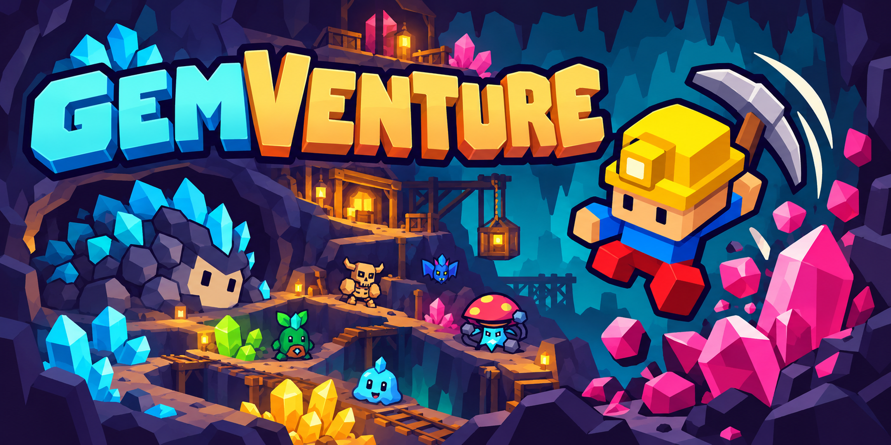
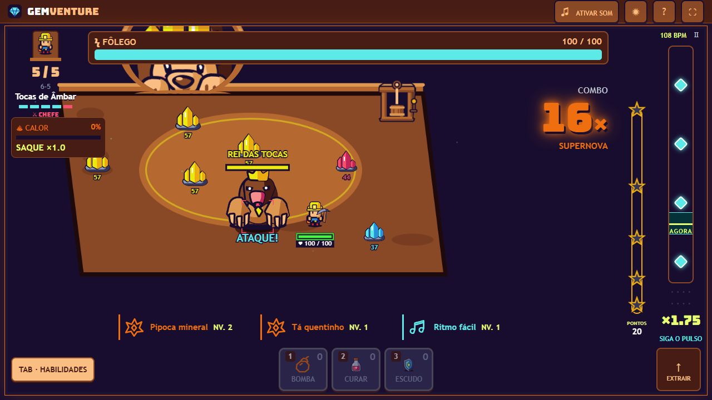
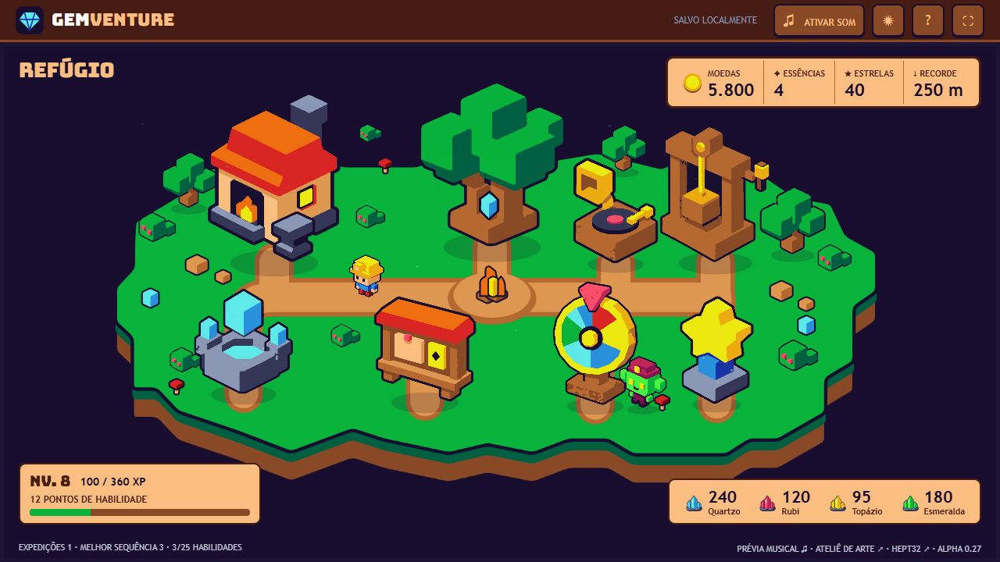
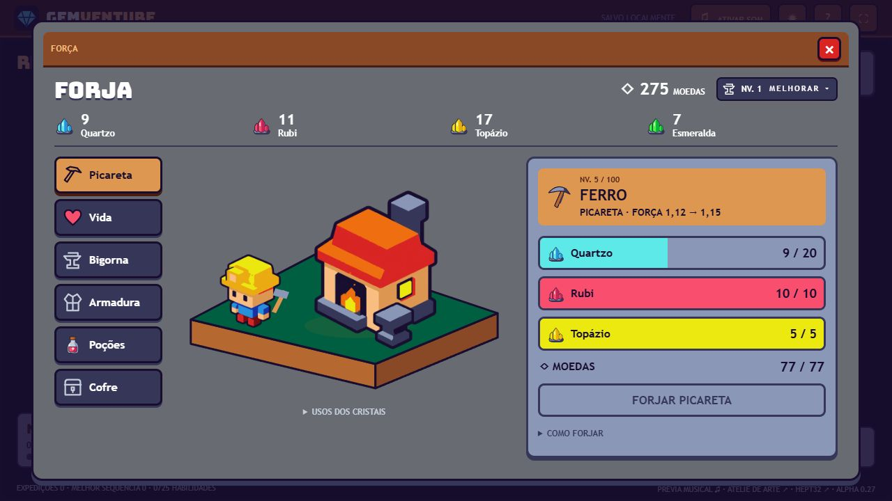
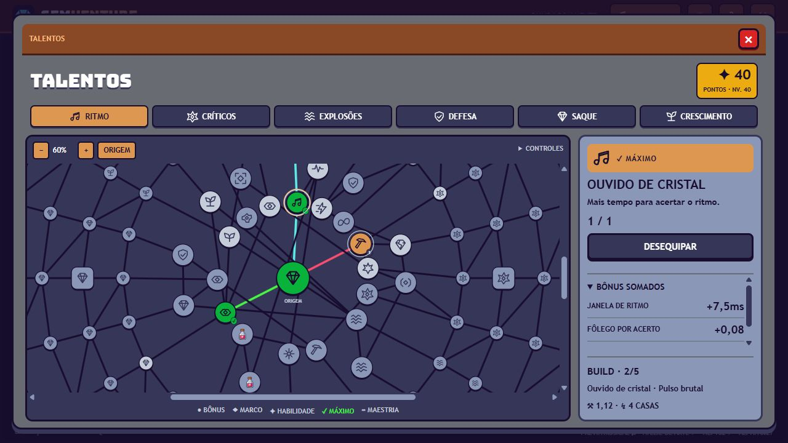
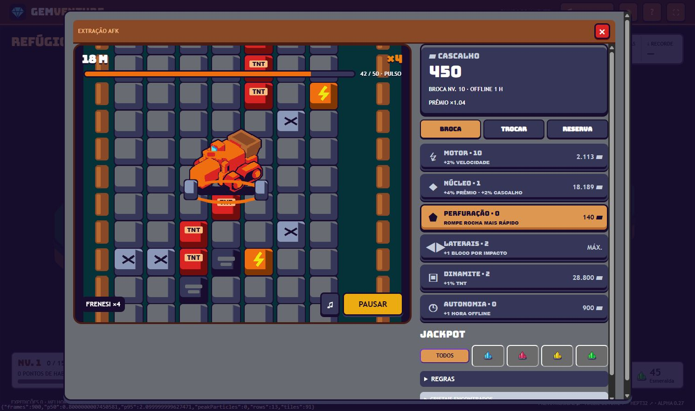

<p align="center">
  
</p>

<h1 align="center">GemVenture</h1>
<p align="center"><strong>Minere no ritmo. Vá mais fundo.</strong></p>

<p align="center">
  <a href="https://github.com/LeandroSatsuki/GemVenture/actions/workflows/ci.yml"></a>
  
  
  
</p>

<p align="center">
  <a href="#jogar-localmente">Jogar</a> ·
  <a href="#o-jogo">O jogo</a> ·
  <a href="docs/ARCHITECTURE.md">Arquitetura</a> ·
  <a href="CONTRIBUTING.md">Contribuir</a> ·
  <a href="CREDITS.md">Créditos</a>
</p>

GemVenture é um jogo de mineração rítmica com progressão incremental e expedições
procedurais. Cada batida é uma decisão: quebrar um cristal, enfrentar uma criatura
ou abrir caminho para o próximo combo. Volte à vila, invista os recursos e prepare
uma nova descida.

**Protótipo jogável em desenvolvimento.** Arte, conteúdo e balanceamento continuam
evoluindo. A capa é uma ilustração promocional; as imagens abaixo mostram a
interface do jogo.

## O jogo

| Modo | Experiência |
| --- | --- |
| **Andares** | Explore, mine, vença o chefe e escolha entre descer ou voltar à vila. |
| **Abismo Infinito** | Mineração e enxames em fluxo contínuo, com risco crescente e escolhas rápidas de cartas. |
| **Broca AFK** | Uma máquina que evolui com cascalho e encontra lotes raros de cristais; profundidade, núcleo e progresso ampliam os prêmios. |

- **Ritmo como regra:** movimentação, ataques, criaturas e sinais compartilham o pulso musical.
- **Cavernas vivas:** corredores, ambientes específicos, recursos variados e chefes com mecânicas próprias.
- **Builds:** cartas temporárias combináveis, uma grande teia de talentos e equipamentos aprimoráveis.
- **Recompensa visível:** combos, estrelas, explosões e números com feedback imediato.
- **Descanso com propósito:** vila interativa, música suave, missões e o tabuleiro tático de Zag.
- **Discos colecionáveis:** gêneros distintos, compra por essências e prévia de cinco segundos.

## A vila

Cada estrutura tem uma função própria:

| Estrutura | Papel |
| --- | --- |
| **Forja** | Força bruta e resistência, usando cristais separados por tipo. |
| **Árvore de Ecos** | Builds e sinergias, usando experiência e pontos de talento. |
| **Poço dos Desejos** | Bênçãos e maldições aleatórias para a próxima descida. |
| **Relicário** | Prestígio, relíquias e desbloqueios pagos com estrelas raras. |
| **Quadro de Missões** | Objetivos escalonados e entrega de recompensas na vila. |
| **Zag** | Tabuleiro, escolhas de dados, rotas, ferramentas e cofres. |
| **Vitrola** | Coleção musical e seleção da trilha. |
| **Broca AFK** | Economia passiva própria; cascalho melhora apenas a máquina. |

## Em imagens

<p align="center">
  
  <br><em>Prévia de combate: o chefe, a rota e o ritmo dividem a mesma cena.</em>
</p>

<table>
  <tr>
    <td><br><strong>Refúgio</strong></td>
    <td><br><strong>Forja</strong></td>
  </tr>
  <tr>
    <td><br><strong>Árvore de Ecos</strong></td>
    <td><br><strong>Broca AFK</strong></td>
  </tr>
</table>

## Jogar localmente

Requer **Node.js 24 ou superior** e um navegador moderno. O jogo usa módulos
nativos, Canvas 2D e Web Audio; não exige instalação de bibliotecas ou compilação.

```bash
git clone https://github.com/LeandroSatsuki/GemVenture.git
cd GemVenture
npm start
```

Abra **http://127.0.0.1:4173/** e ative o som pelo botão **♫**.
O navegador inicia o áudio após uma interação.

Para usar outra porta:

```powershell
# Windows / PowerShell
$env:PORT = '4174'
npm start
```

```bash
# macOS / Linux
PORT=4174 npm start
```

O progresso fica salvo no navegador. **Host e porta diferentes mantêm saves
separados.** Não abra o HTML diretamente: o servidor local é necessário para
carregar os módulos.

## Controles

| Ação | Controle |
| --- | --- |
| Mover, minerar ou atacar | Clique no cenário ou no alvo |
| Continuar golpeando | Espaço |
| Esquivar no ritmo | WASD ou setas |
| Abrir habilidades | Tab |
| Trocar alvo | Q |
| Usar habilidades/itens | 1, 2 e 3 |
| Pausar | P ou Esc |
| Pedir extração | E |
| Ativar ou silenciar áudio | ♫ |

## Desenvolvimento

```bash
npm test
npm run audit:art
npm run audit:miner
npm run catalog
```

A suíte cobre combate, ritmo, chefes, exploração, economia, migrações de save,
cartas e geração de arte. GitHub Actions executa validação automática em Linux e
Windows. O jogo é servido diretamente de `dist/`; essa pasta contém o código
fonte atual, não uma compilação descartável.

| Pasta | Conteúdo |
| --- | --- |
| `dist/` | Jogo, interface, sistemas de áudio e arte em tempo de execução |
| `tests/` | Testes e prévias isoladas de QA |
| `tools/` | Auditorias de economia e exportação de referências |
| `docs/` | Arquitetura, direção de arte, histórico e mídia |
| `skills/` | Regras do gerador de arte procedural do projeto |

Ferramentas visuais locais: [ateliê](http://127.0.0.1:4173/art-studio.html),
[catálogo de assets](http://127.0.0.1:4173/asset-catalog.html),
[laboratório musical](http://127.0.0.1:4173/music-lab.html) e
[relatório de balanceamento](http://127.0.0.1:4173/balance-report.html).

## Documentação

- [Arquitetura e persistência](docs/ARCHITECTURE.md)
- [Direção de arte e capa](docs/art/README.md)
- [Regras de produto](DESIGN_RULES.md)
- [Assets e referências](ART_ASSETS.md)
- [Economia da Broca AFK](MINERADORA.md)
- [Direção musical](MUSIC_DIRECTION.md)
- [Histórico técnico](docs/technical/development-history.md)
- [Contribuição](CONTRIBUTING.md) · [Créditos](CREDITS.md)

## Estado e direitos

O catálogo de conquistas está preparado para futura integração com Steam; o SDK
Steamworks e a publicação na loja **ainda não estão integrados**. O save atual é
local; não há sincronização de nuvem ou proteção contra edição manual.

Desenvolvido por [LeandroSatsuki](https://github.com/LeandroSatsuki).
Código, marca, arte e música mantêm **direitos reservados**; publicar o repositório
não concede licença de reutilização. Consulte [LICENSE](LICENSE) e
[CREDITS.md](CREDITS.md).
