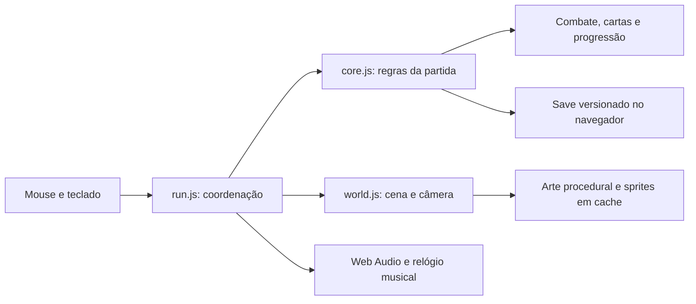

# Arquitetura

GemVenture usa JavaScript em módulos ES, Canvas 2D e Web Audio. Não há framework,
bundler ou dependências de execução. O Node.js serve os arquivos de `dist/` para
o navegador; toda a simulação atual acontece localmente.

## Fluxo

## Sistemas

| Área | Módulos principais |
| --- | --- |
| Partida e entrada | `run.js`, `core.js`, `choice-guard.js` |
| Ritmo e áudio | `score.js`, `audio.js`, `music-arrangements.js`, `sound-design.js` |
| Mundo e câmera | `world.js`, `cave-layout.js`, `cavern.js`, `cave-ceiling.js` |
| Criaturas e chefes | `creatures.js`, `bosses.js`, `campaign.js` |
| Builds e equipamentos | `talents.js`, `cards.js`, `gear.js`, `astral.js` |
| Vila e recursos | `forge.js`, `village.js`, `missions.js`, `pillars.js` |
| Fluxo contínuo | `frenzy.js`, `abyss-cards.js`, `descent-progress.js` |
| Mineração passiva | `miner.js`, `miner-view.js` |
| Tabuleiro | `zag.js`, `zag-view.js` |
| Arte | `palette.js`, `art-kit.js`, `scene-art.js`, `flow-village.js` |

Os módulos terminados em `-view.js` apresentam sistemas cujas regras ficam em
módulos separados. CSS organiza leitura e feedback, sem decidir resultados de
combate ou transações.

## Persistência

O estado é armazenado em `localStorage`, na chave `gemventure-save-v2`. A leitura
valida dados e aplica migrações compatíveis. Host, porta e perfil de navegador
separam saves; não há sincronização entre máquinas ou abas concorrentes.

`miner.js` processa renda por timestamps e trabalho inteiro. A renderização não
concede recursos. Tempo já processado não pode ser coletado novamente. Janelas
offline e histórico de blocos são limitados.

## Desempenho e arte

Mundos procedurais têm entidades e reposição limitadas. Geometria estática,
rasters e partes animáveis são reutilizados em caches; a câmera acompanha o
personagem suavemente. O modo de efeitos suaves reduz deslocamentos e partículas.

A vila usa peças PNG próprias, com alfa e normalização HEPT32 em tempo de
execução. A caverna usa sua projeção própria; não misture câmeras ao gerar assets.
`dist/pack-art.js` mantém um nome de compatibilidade, mas contém partes originais
na versão pública. O importador de pacotes privados não é publicado.

## Verificação

`npm test` executa testes de regras, economia, geração, persistência e regressões.
`npm run check` verifica sintaxe e referências locais do jogo/README. QA visual
usa `node tests/ui-review-server.mjs 4181`, com fixtures apenas nessa origem.

As ferramentas de Steam hoje exportam um catálogo de conquistas. Isso não
equivale a uma integração Steamworks ou a um build nativo publicado.
