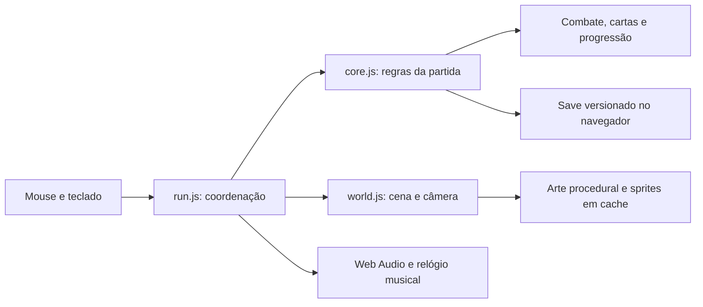

# Arquitetura

GemVenture usa JavaScript em módulos ES, Canvas 2D e Web Audio. Não há framework,
bundler ou dependências de execução. O Node.js serve os arquivos de `dist/` para
o navegador; toda a simulação atual acontece localmente.

## Fluxo

## Sistemas

| Área | Módulos principais |
| --- | --- |
| Partida e entrada | `run.js`, `core.js`, `choice-guard.js` |
| Ritmo e áudio | `score.js`, `audio.js`, `music-arrangements.js`, `sound-design.js` |
| Mundo e câmera | `world.js`, `cave-layout.js`, `cavern.js`, `cave-ceiling.js` |
| Criaturas e chefes | `creatures.js`, `bosses.js`, `campaign.js` |
| Builds e equipamentos | `talents.js`, `cards.js`, `gear.js`, `astral.js` |
| Vila e recursos | `forge.js`, `village.js`, `missions.js`, `pillars.js` |
| Fluxo contínuo | `frenzy.js`, `abyss-cards.js`, `descent-progress.js` |
| Mineração passiva | `miner.js`, `miner-view.js` |
| Tabuleiro | `zag.js`, `zag-view.js` |
| Arte | `palette.js`, `art-kit.js`, `scene-art.js`, `flow-village.js` |

Os módulos terminados em `-view.js` apresentam sistemas cujas regras ficam em
módulos separados. CSS organiza leitura e feedback, sem decidir resultados de
combate ou transações.

## Persistência

O estado é armazenado em `localStorage`, na chave `gemventure-save-v2`. A leitura
valida dados e aplica migrações compatíveis. Host, porta e perfil de navegador
separam saves; não há sincronização entre máquinas ou abas concorrentes.

`miner.js` processa renda por timestamps e trabalho inteiro. A renderização não
concede recursos. Tempo já processado não pode ser coletado novamente. Janelas
offline e histórico de blocos são limitados.

## Desempenho e arte

Mundos procedurais têm entidades e reposição limitadas. Geometria estática,
rasters e partes animáveis são reutilizados em caches; a câmera acompanha o
personagem suavemente. O modo de efeitos suaves reduz deslocamentos e partículas.

A vila usa peças PNG próprias, com alfa e normalização HEPT32 em tempo de
execução. A caverna usa sua projeção própria; não misture câmeras ao gerar assets.
`dist/pack-art.js` mantém um nome de compatibilidade, mas contém partes originais
na versão pública. O importador de pacotes privados não é publicado.

### Otimizações da caverna (02/11/2026)

- `cave-navigation.js` mantém até quatro fronteiras BFS derivadas por sala,
  expandidas somente até o alvo. Preserva a ordem direita/esquerda/baixo/cima,
  verifica alterações de chão por valor e invalida rochas e corpos/ondas sólidos.
  A perseguição só prepara o campo quando um inimigo realmente precisa dele.
- Nascimento de entidades consulta conectividade compartilhada sem consumir RNG
  adicional, reduzir populações ou trocar as regras de posicionamento.
- `save-snapshot.js` reutiliza o JSON de grades numéricas após comparação de
  valores. As gravações continuam síncronas, com o mesmo esquema e texto JSON;
  não há debounce, novo armazenamento nem migração de save.
- Avisos reutilizam o plano de posição até mudar conteúdo, visibilidade, tamanho,
  transformações do HUD ou viewport. Navegadores sem observers mantêm o caminho
  anterior. Não há alterações de CSS, fontes ou dimensões.
- O stream mantém o orçamento de 4 ms para carregamento inicial e blocos visíveis
  ausentes; apenas a antecipação não urgente usa 2 ms/32 unidades por chamada.
  Conteúdo, rasters, limite de cache e sementes permanecem iguais.

## Verificação

`npm test` executa testes de regras, economia, geração, persistência e regressões.
`npm run check` verifica sintaxe e referências locais do jogo/README. QA visual
usa `node tests/ui-review-server.mjs 4181`, com fixtures apenas nessa origem.

As ferramentas de Steam hoje exportam um catálogo de conquistas. Isso não
equivale a uma integração Steamworks ou a um build nativo publicado.

### Cavernas comuns com menos salas — 02/11/2026

Novas cavernas comuns usam layout.version=3: 15 salões principais e três câmaras
laterais em 160 × 108 células. São 40% menos salas que as 30 anteriores, mantendo
as dimensões de cada salão e o acesso por corredores. A grade tem 37,5% menos
células. Partidas salvas em layout.version=2 conservam suas 30 salas e grade
192 × 144, sem regeneração. O schema global do save não muda. Arenas dos bosses
e a janela contínua do Abismo seguem com suas dimensões e geração existentes.
A redução diminui trabalho global; o custo de rasterizar um bloco e a espera por
blocos ausentes no stream continuam sujeitos a validação de gameplay real.

### Preparação dos trechos em segundo plano — 02/11/2026

A campanha prepara rasters estáticos de chão, paredes e terrenos em um worker
Canvas 2D, transferindo ImageBitmaps para o cache existente. Há um worker por
cena, no máximo dois pedidos em andamento, 64 entradas e 64 MiB para os rasters
residentes; buffers de trabalho e cache limitado de tiles são separados. A
antecipação tem uma borda em todas as direções e 24 células à frente. Trechos
parcialmente preparados sobrevivem a mudanças de direção dentro do LRU.
Falha, falta de suporte ou timeout retornam ao gerador síncrono com o mesmo
conteúdo. Troca de cena termina worker, cancela pedidos e fecha bitmaps, inclusive
resultados atrasados. Não há novo campo de save nem alteração de geometria,
colisão, gameplay, arte fonte, Abismo ou tamanho dos salões.
