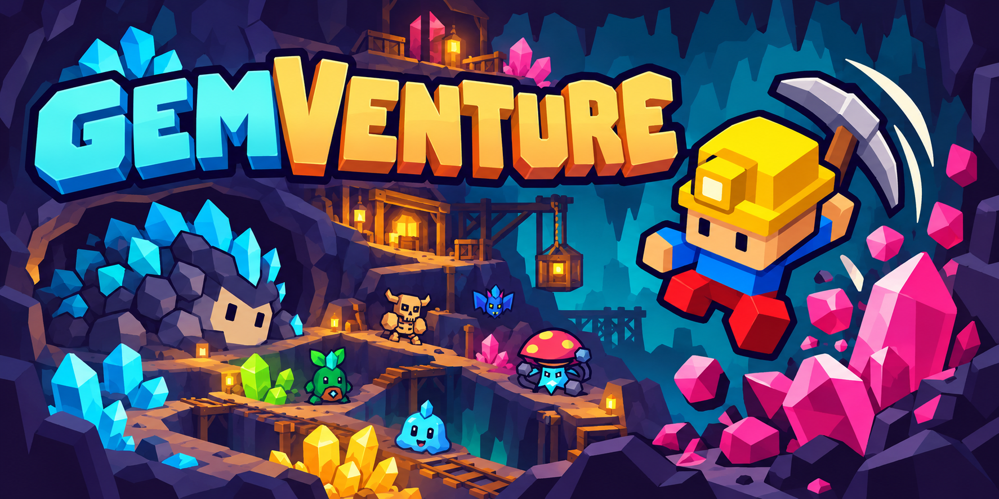

# Direção de arte

## Refúgio noturno ativo · 27/10/2026

[Contrato e fontes do Refúgio Mágico](refuge-night-v1.md): tela fixa de preparação,
minerador procedural v3 aprovado, árvore e pets aprovados em camadas próprias.
Este contrato substitui a vila explorável na tela inicial; as seções históricas
abaixo e seus assets permanecem preservados. Nenhuma mudança global de paleta.

Uma identidade compartilhada: **HEPT32, silhuetas grandes, volumes sólidos,
contorno escuro e uma sombra por material**. Cristais usam facetas regulares;
criaturas usam corpos e articulações mais suaves.

- Vila: perspectiva ortográfica isométrica em 3/4, com pontos de apoio coerentes.
- Caverna: projeção semi-top-down do renderizador, com posição lógica independente
  do quique/teleporte visual.
- Interface: pedra cinza, madeira, seleção ocre e cores que distinguem recursos.
- Efeitos: ação legível, perigos preservados e partículas com limites.

## Capa

Arquivo principal: `docs/media/gemventure-cover.png`, proporção 2:1.
Pode ser usado no README e como imagem de prévia social do repositório. A arte é
promocional; não representa uma captura da jogabilidade.

Produzida com a ferramenta integrada de geração de imagens a partir dos assets
do projeto. [Prompt utilizado](cover-prompt.md). O original gerado foi preservado;
não houve edição externa para compor este arquivo.

## Assets de produção

[78 PNGs aprovados agora ativos no runtime](approved-runtime-art.md):
cristais, rochas, criaturas e chefes, com fontes preservadas e âncoras
validadas. A arte raster aprovada mantém seu acabamento original;
não passa pela quantização de paleta das imagens antigas da vila.

[Animações de gosmas, morcegos e geodos](minion-animation-contract.md):
frames dos novos PNGs, contato na batida e divisão entre arte, efeitos e
avisos de chão. Corpos em produção por camadas/poses controladas; mortes
e poças específicas já integradas em `dist/assets/minion-vfx/`.

[Ouriço da toca: referência, poses e interação](hedgehog-interaction.md):
picaretada no ritmo provoca reação triste e brotação limitada. A arte
nova foi solicitada ao diretor de assets e ainda aguarda entrega.

Terrenos: [contrato de encaixe e spritesheets por material](terrain-kit-v2.md).
Prévia técnica em `/terrain-studio.html`, com guias PNG/SVG e prompts.

Efeitos agora usam cinco folhas PNG substituíveis em `dist/assets/vfx/`.
Veja [formatos, limites e guia de substituição](vfx-assets.md) e a prévia
local em `/vfx-gallery.html`.

Veja [ART_ASSETS.md](../../ART_ASSETS.md), o catálogo local e a skill em
`skills/gemventure-procedural-art/SKILL.md`. Pacotes baixados, rascunhos e assets
com licença restrita ficam fora do repositório público.

- [Paredes ilustradas das Grutas: montagem, cache e validação](wall-art.md).

- [Cavernas gigantes de campanha, arenas e preparação por setores](campaign-caves-v1.md).
